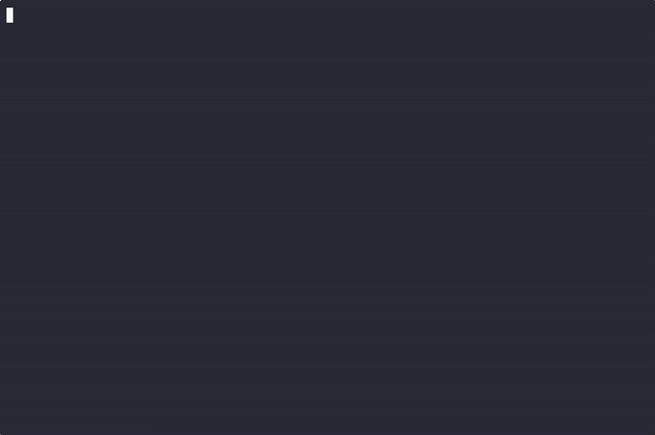

# TesseractAtlas — complete Full-stack app command-line tool example app

Want to run your own command-line tool without paying for SaaS? **TesseractAtlas** is a free, Apache-2.0-licensed Full-stack app project that you can clone and self-host today. TesseractAtlas is a single-file, standard-library Python command-line tool for beadwork designers: it imports a beaded pattern from a plain-text or CSV grid, allows small cell touch-ups, previews the grid as a virtual…. Every TesseractAtlas feature — every screen, every seed record — is here. [Open TesseractAtlas on cenius.ai](https://cenius.ai/marketplace/p/tesseractatlas?ref=gh&utm_campaign=tesseractatlas-webapp) to modify it without writing code.


[](LICENSE)  [](https://cenius.ai)

[](https://cenius.ai/marketplace/p/tesseractatlas?ref=gh&utm_campaign=tesseractatlas-webapp)

> **▶ [Open & edit in cenius.ai](https://cenius.ai/marketplace/p/tesseractatlas?ref=gh&utm_campaign=tesseractatlas-webapp)** — one click to an editable workspace: describe changes in plain English, get an instant preview, one-click deploy and host. Modifications made on the platform come with full rebrand & relicense rights.

_Local clone? See [Quick start](#quick-start) below. cenius.ai is the zero-setup path._

## Demo



📽 **[Demo video on cenius.ai](https://cenius.ai/marketplace/p/tesseractatlas?ref=gh&utm_campaign=tesseractatlas-webapp)** — the complete run-through · [MP4](.github/media/demo.mp4)

## Features

- Local passphrase profile (sign in)
- Pattern import from text/CSV grid
- Grid viewer with rulers and legend
- In-tool cell editor for touch-ups
- Virtual pattern folding with net preview
- Colourway inventory with dye-lot notes
- Print-friendly stitch map export
- Pattern library list, open, rename, delete
- Machine-readable JSON output
- Configurable export page tiling

## Quick start

```bash
./install.sh   # installs dependencies + seeds demo data
```

See [`INSTALL.md`](INSTALL.md) for full setup and usage instructions.

## Architecture

Everything runs out of the box: a Full-stack app codebase (14 files). `./install.sh` gets you from a fresh clone to a running instance with sample data in a single step. Top-level layout: `demo/`, `examples/`, `tests/`. Installation walkthrough: [`INSTALL.md`](INSTALL.md).

## Usage guide

Every command runs as `python3 tesseract_atlas.py <command> ...` (or `tesseract-atlas
<command> ...` after `bash install.sh`). Global flags work before or after the
command: `--state-dir DIR`, `--reset-state`, `--version`.

Exit codes: `0` success, `1` a validation/auth/data error (message on stderr, nothing
half-written), `2` a bad command line.

### 1. Local profiles

```bash
python3 tesseract_atlas.py signup --name ana --passphrase 'teal-lattice-7' --confirm 'teal-lattice-7'
python3 tesseract_atlas.py login  --name ana --passphrase 'teal-lattice-7'
python3 tesseract_atlas.py status
python3 tesseract_atlas.py logout
```

* Passphrases are stored only as `hashlib.scrypt` hashes (n=16384, r=8, p=1, 32-byte
  digest) with a fresh 16-byte random salt per profile.
* A new passphrase needs at least 8 characters - the message says how long yours was.
* Unknown profile and wrong passphrase produce the **same** one-line message and leave
  the active profile untouched.
* With more than one profile, `login` without `--name` prints the profile picker.
* `signup`, `login` and `logout` write/clear the active-profile marker in the state
  file; every other command requires it.
* Recovery is local: delete `.tesseractatlas/state.json` (or run any command with
  `--reset-state`, which archives the old file instead of deleting it).

### 2. Import a grid

```bash
python3 tesseract_atlas.py import examples/sample.stitch.csv
python3 tesseract_atlas.py import my-grid.txt --name "Spring Lattice"
python3 tesseract_atlas.py import my-grid.csv --delimiter semicolon --dry-run
```

_Full guide: [`USAGE.md`](USAGE.md)_

## FAQ

### Can I deploy TesseractAtlas on my own infrastructure?

Everything you need ships in this repo: clone it, run `./install.sh` to install dependencies and seed demo data, then follow [`INSTALL.md`](INSTALL.md) to start it. No external services required.

### What is TesseractAtlas built with?

Full-stack app end-to-end. Every file you need to run the app is here in this repository — code, configuration, seed data. Highlights include pattern library list, open, rename, delete.

### What license does TesseractAtlas use?

It is. Apache-2.0 licensing means you can build a product on it, sell it, or use it inside a company with no fees. Details: [LICENSE](LICENSE).

### Is white-labeling TesseractAtlas allowed?

White-labeling is supported: fork the MIT-licensed source and rebrand it yourself, or use [cenius.ai](https://cenius.ai/marketplace/p/tesseractatlas?ref=gh&utm_campaign=tesseractatlas-webapp) to make changes in a guided workspace — platform modifications come with full rebrand rights.

### Is there a no-code way to modify TesseractAtlas?

Yes — [load it on cenius.ai](https://cenius.ai/marketplace/p/tesseractatlas?ref=gh&utm_campaign=tesseractatlas-webapp), describe the change in plain English, and you get back a fresh build with your modification applied.

## License & rebranding

Released under the [Apache License 2.0](LICENSE) (© 2026 Cenius AI) — free for personal and commercial use. The Cenius name/logo are trademarks (see NOTICE).

**Need a customized version?** [Remix this app on cenius.ai](https://cenius.ai/marketplace/p/tesseractatlas?ref=gh&utm_campaign=tesseractatlas-webapp) — modifications made on the platform come with **full rebrand & relicense rights** over your derivative.

## Built with cenius.ai

This entire application — code, design, seeded demo data — was generated on **[cenius.ai](https://cenius.ai)** from a plain-English description.

- 🚀 [Build your own app on cenius.ai](https://cenius.ai)
- 🎛️ [Remix TesseractAtlas on the marketplace](https://cenius.ai/marketplace/p/tesseractatlas?ref=gh&utm_campaign=tesseractatlas-webapp) — open it in a workspace, prompt for changes, and ship your own version.

More open-source apps: [the Cenius-ai catalog](https://github.com/Cenius-ai) · [showcase index](https://github.com/Cenius-ai/showcase)
